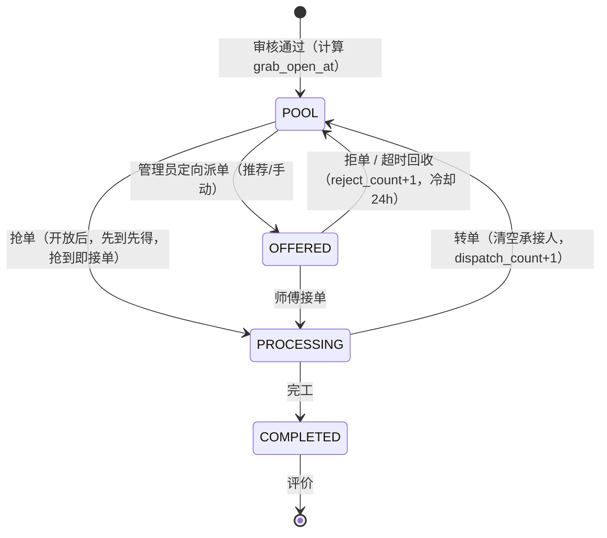

# 派单与抢单调度：问题诊断与重构方案

> 范围：`CPS/backend` 派单（F4-1/4-2）、抢单（F4-4）、接单/拒单/转单（F5-2/F5-5）、负载与推荐（§7.2）
> 结论：**当前实现不是「小 bug」，而是调度模型缺少一层抽象**。一条 `PENDING` 同时承担「待派单」和「已派待接」两种语义，派单与抢单又是两条互不感知的通道，因此产生了覆盖、超卖、无限挂起、分页错乱等一串问题。
> 本文给出可直接落地的目标模型、并发方案、评分模型、DDL、接口变更与分阶段实施路径。

---

## 1. 结论摘要

| 级别 | 问题 | 后果 |
|------|------|------|
| P0 | 管理端「待派单」= 全部 PENDING，含已被抢/已派单 | 管理员可无提示地覆盖师傅抢到的单 |
| P0 | 抢单池对**所有**待处理单无差别开放 | 与需求「紧急单广播」不符；好单被抢、难单积压 |
| P0 | 抢单是两步（claim → accept），抢到不算接单 | 可无限期占用；与「先到先得」语义冲突 |
| P0 | 负载上限是「读-判断-写」，无锁 | 并发下同一师傅可被超派 |
| P0 | 抢单池先分页再内存过滤 | `total` 只等于当前页命中数；首页抢单数恒为 0/1；整页可能空白 |
| P0 | 维修工无权限查看待派单详情 | 抢单前看不到图片/详细位置，只能盲抢 |
| P1 | 拒单/转单/改派不清空 `assigned_at`、`accepted_at` | 派单子状态错乱，响应时长统计失真 |
| P1 | 无超时回收，`is_overdue` 从未置位 | 派出去没人接的单永远挂着 |
| P1 | 无派单来源/次数/拒单计数 | 抢单占比、拒单率、难派单都统计不了 |
| P1 | 同一套资格规则写了两遍 | 两处实现容易漂移 |
| P1 | 「推荐」只按评价均分排序 | 没有负载、及时率、技能精度，等于没推荐 |
| P2 | 列表 VO 无 `workerId`，前端按姓名比较 | 重名即错判「重新派单」 |
| P2 | 需求 §7.2 的 `CampusMatch` 权重恒为 1 | 该因子是常数，白占 0.20 权重 |

**一句话**：现在缺的不是补丁，是「派单子状态」和「容量令牌」这两个概念。

---

## 2. 现状还原（代码级证据）

| 动作 | 入口 | 实际行为 | 问题 |
|------|------|----------|------|
| 审核通过 | `OrderStateMachine#L43` | `PENDING_AUDIT → PENDING`，`worker_id` 为空 | 工单同时进入「待派单池」和「抢单池」 |
| 管理员派单 | `OrderService#assign` (L292) | `PENDING` 不变，回填 `worker_id`、`assigned_at` | 与「待派单」同状态，无法区分 |
| 抢单 | `OrderService#claim` (L364) | `PENDING` 不变，回填本人 | 抢到 ≠ 接单，需再点一次「接单」 |
| 接单 | `OrderService#accept` (L304) | `PENDING → PROCESSING` | 与抢单割裂 |
| 拒单 | `OrderService#rejectAssign` (L376) | `worker_id = null`，`PENDING` 不变 | `assigned_at` 残留 |
| 转单 | `OrderService#transfer` (L388) | `worker_id = null`，`PROCESSING → PENDING` | `accepted_at`、`completed_at` 残留 |
| 管理端待派单 | `DispatchWorkbench.vue#load` (L166) | `GET /orders?status=PENDING` | **未过滤 `worker_id IS NULL`** |
| 维修工待接 | `OrderService#mineAssigned` (L240) | `worker_id = me AND status = PENDING` | 与「待派单」共用状态 |
| 抢单池 | `OrderService#grabPool` (L310) | 先 `selectPage` 再 `filter(selfFailReasons)` | 分页/总数/性能三错 |
| 资格判定 | `WorkerService#eligibleWorkersForOrder` / `#selfFailReasons` | 两套代码、同一规则 | 规则漂移风险 |
| 推荐排序 | `WorkerService` L305 | `eligible desc, score desc` | 仅评价分，非多因子 |

### 2.1 一个具体的错乱链路

```
1. 管理员打开派单工作台 → 看到工单 A（PENDING，未派）
2. 维修工张三在抢单大厅抢到 A → worker_id = 张三，status 仍为 PENDING
3. 管理员页面未刷新，仍看到 A 在「待派单」列表里（因为查询没过滤 worker_id）
4. 管理员把 A 派给李四 → assign 不校验「是否已被承接」，直接覆盖
5. 张三的待接列表里 A 消失，无任何通知；张三认为系统丢单
```

第 4 步在 `OrderService#assign` 里没有任何 `worker_id IS NULL` 条件，状态机 `ASSIGN` 的 guard 也是 `o -> true`，所以覆盖一定成功。

### 2.2 抢单池分页为什么是错的

```java
Page<RepairOrder> p = orderMapper.selectPage(new Page<>(page, Math.min(pageSize, 50)), w);
List<RepairOrder> eligible = p.getRecords().stream()
        .filter(o -> workerService.selfFailReasons(o).isEmpty())
        .toList();
return new PageVO<>(toListVOs(eligible), eligible.size());   // total = 当前页命中数
```

- 第 1 页取 20 条，其中 3 条符合 → `total = 3`，第 2 页永远点不到；
- 若整页 20 条都不符合 → 返回空列表，但后面其实还有可抢单；
- 首页 `GET /orders/grab-pool?pageSize=1` 的 `total` 只能是 0 或 1（`home.js` L125/L149 的抢单数就是错的）；
- 每条候选都要查一次技能、一次校区、一次负载 → N+1 查询。

### 2.3 负载上限为什么挡不住超卖

```java
int load = loads.getOrDefault(u.getId(), 0L).intValue();  // 读
if (load >= limit) reasons.add("负载已满");                // 判
transition(o, CLAIM, ..., uid);                            // 写（不同工单，乐观锁互不相干）
```

乐观锁保护的是**同一张工单**，不是**同一个师傅的容量**。师傅 A 上限 3、当前 2，同时抢两张不同的单，两个事务都能读到 `load = 2`，都能通过，最终 `load = 4`。

---

## 3. 目标模型

### 3.1 核心决策：主状态 × 派单子状态（派生，不落库）

工单有两条正交的生命周期：

- **主状态**：待审核 → 待处理 → 处理中 → 已完成 → 已评价（业务生命周期，报告 §5 的 7 状态不变）
- **派单子状态**：待派单 → 已派待接 → 已承接（调度过程）

派单子状态**由现有字段派生**，不新增冗余状态列，避免双写不一致：

```java
public enum DispatchState {
    NONE,     // 不在派单阶段
    POOL,     // 待派单：status=PENDING && worker_id IS NULL
    OFFERED,  // 已派待接：status=PENDING && worker_id IS NOT NULL
    TAKEN     // 已承接：status ∈ {PROCESSING, COMPLETED, EVALUATED}
}

static DispatchState of(RepairOrder o) {
    if (o.getStatus() != OrderStatus.PENDING) return DispatchState.NONE;
    return o.getWorkerId() == null ? DispatchState.POOL : DispatchState.OFFERED;
}
```

> 为什么不直接加一个 `ASSIGNED` 主状态？
> ① 主状态会被报表、状态机、前端标签、超时口径全部引用，加一个状态要改一圈；
> ② 派单只是「待处理」阶段内部的过程，升格为主状态会让状态机从 7 条变 9 条，且「处理中」到「待处理」的转单会跨状态回退，语义更乱。
> ③ 派生状态只有一个事实来源，永远不会和 `worker_id` 打架。

**但要补齐三个派生不出来的事实**（必须落库）：

| 字段 | 作用 |
|------|------|
| `dispatch_source` | MANUAL / GRAB / AUTO，支撑「抢单占比」「自动采纳率」 |
| `grab_open_at` | 该单进入抢单池的开放时间（紧急单=审核即开，普通单=延迟开放） |
| `assign_expires_at` | 本次派单的接单截止时间，超时回收的依据 |

### 3.2 不变量（实现与测试都以此为准）

| 编号 | 不变量 |
|------|--------|
| I1 | `status=PENDING && worker_id IS NULL` ⇔ 可派单、可抢单 |
| I2 | `status=PENDING && worker_id IS NOT NULL` ⇒ 已派待接，且 `assign_expires_at IS NOT NULL` |
| I3 | `status=PROCESSING` ⇒ `worker_id IS NOT NULL && accepted_at IS NOT NULL && due_at IS NOT NULL` |
| I4 | 同一工单任一时刻只有一个 `worker_id`（条件更新保证） |
| I5 | `load(w) = count(status IN (PENDING,PROCESSING) AND worker_id=w) ≤ load_limit`，除非管理员显式强制 |
| I6 | 每次状态变更与 `order_log` 同事务写入 |
| I7 | 工单回到 `POOL` 时必须清空 `worker_id / assigned_at / accepted_at / assign_expires_at` |

---

## 4. 调度策略：一条升级阶梯

### 4.1 为什么现在的「全量开放抢单」是错的

需求 F4-4 写的是「**紧急工单**广播给全部匹配维修工，先到先得」。现在把所有待处理单都放进抢单池，会产生两个必然结果：

1. **挑肥拣瘦**：师傅只抢近的、简单的、配件齐的，难单在池子里越积越久；
2. **双通道打架**：管理员刚打开看板准备派单，单已经被抢走了，管理员的调度权被架空。

### 4.2 目标流程



三条规则：

**R1 定向派单优先。** 审核通过后，工单先在 `POOL` 里等管理员派单，给一个「定向窗口」（普通单 20 分钟，紧急单 0 分钟）。

**R2 抢单只作为兜底/紧急通道。** 抢单池的可见条件是：

```
status = PENDING
AND worker_id IS NULL
AND grab_open_at IS NOT NULL
AND grab_open_at <= NOW()
```

`grab_open_at` 在审核通过时写入：

| 场景 | grab_open_at |
|------|--------------|
| 紧急单 | `NOW()`（立即广播） |
| 普通单 | `NOW() + 20min`（留给管理员定向派单） |
| 管理员手动「开放抢单」 | `NOW()` |
| 被拒/转单回流且 `dispatch_count >= 2` | `NOW()`（难单立即广播） |

**R3 抢单即接单。** 抢单成功后直接 `PENDING → PROCESSING`，写 `accepted_at`、`due_at`、`dispatch_source=GRAB`。不再要求二次确认。

> 原实现为了「保持派单→接单的响应时长口径」而保留二次确认，这个取舍的代价是：抢到的单可以被无限期占着不接，且「先到先得」变成了「先占到」。正确做法是**把口径拆开**——`派单响应 = accepted_at - assigned_at`，`抢单响应 = accepted_at - grab_open_at`，而不是靠多一步操作去凑统计。

### 4.3 回流与冷却

| 事件 | 处理 |
|------|------|
| 拒单 | 回 `POOL`，`reject_count+1`，记录 `(order, worker)`；该师傅 24h 内不再被推荐、不可再抢此单 |
| 接单超时 | 定时任务回收，等同拒单，日志记「超时回收」 |
| 转单 | 回 `POOL`，`dispatch_count+1`，清空承接信息；原师傅 24h 内不再被推荐此单 |
| `dispatch_count >= 3` | 标记「难派单」，管理端置顶 + 红色标识，建议人工介入 |

冷却不需要新表：`order_log` 已有 `order_id / action / operator_id`，直接查即可。

---

## 5. 并发与容量：容量令牌

### 5.1 分工

- **工单行**：乐观锁（`version` + 状态条件）。冲突少，不阻塞。
- **师傅容量行**：悲观锁（`SELECT ... FOR UPDATE`）。必须串行，否则一定超卖。

### 5.2 派单

```java
@Transactional
public void assign(Long orderId, Long workerId, String reason) {
    // 1) 先锁目标师傅的容量行（固定锁序：worker → order）
    WorkerProfile wp = profileMapper.selectForUpdate(workerId);
    if (wp == null || !wp.getOnDuty()) throw param("该师傅不在岗");

    // 2) 读工单
    RepairOrder o = load(orderId);
    if (o.getStatus() != PENDING) throw conflict("工单不在待处理阶段");
    boolean reassign = o.getWorkerId() != null && !o.getWorkerId().equals(workerId);
    if (reassign && !StringUtils.hasText(reason)) throw param("改派必须填写理由");
    if (workerId.equals(o.getWorkerId())) return;              // 幂等

    // 3) 容量校验（锁内，排除本单）
    int load = orderMapper.countActiveByWorker(workerId, orderId);
    if (load >= wp.getLoadLimit()) throw conflict("负载已满（" + load + "/" + wp.getLoadLimit() + "）");

    // 4) 条件更新
    int rows = orderMapper.update(null, new LambdaUpdateWrapper<RepairOrder>()
            .eq(RepairOrder::getId, orderId)
            .eq(RepairOrder::getVersion, o.getVersion())
            .eq(RepairOrder::getStatus, PENDING)
            .set(RepairOrder::getWorkerId, workerId)
            .set(RepairOrder::getAssignedAt, now())
            .set(RepairOrder::getAssignExpiresAt, now().plus(acceptTimeout(o.getUrgency())))
            .set(RepairOrder::getDispatchSource, MANUAL)
            .setSql("dispatch_count = dispatch_count + 1")
            .set(RepairOrder::getVersion, o.getVersion() + 1));
    if (rows != 1) throw conflict("工单状态已变化，请刷新后重试");
    logService.log(orderId, reassign ? REASSIGN : ASSIGN, uid, role, reason);
}
```

### 5.3 抢单（原子抢到即接单）

```java
@Transactional
public void claim(Long orderId) {
    Long uid = AuthContext.userId();
    WorkerProfile wp = profileMapper.selectForUpdate(uid);     // 锁自己
    if (!Boolean.TRUE.equals(wp.getOnDuty())) throw param("当前不在岗");

    RepairOrder o = load(orderId);
    if (o.getStatus() != PENDING || o.getWorkerId() != null) throw conflict("手慢了，已被承接");
    if (o.getGrabOpenAt() == null || o.getGrabOpenAt().isAfter(now())) throw conflict("该单尚未开放抢单");
    dispatchPolicy.assertEligible(uid, o);                     // 技能 / 校区（不含负载）

    if (orderMapper.countActiveByWorker(uid, null) >= wp.getLoadLimit())
        throw conflict("负载已满");

    int rows = orderMapper.update(null, new LambdaUpdateWrapper<RepairOrder>()
            .eq(RepairOrder::getId, orderId)
            .eq(RepairOrder::getVersion, o.getVersion())
            .eq(RepairOrder::getStatus, PENDING)
            .isNull(RepairOrder::getWorkerId)                   // 先到先得
            .set(RepairOrder::getWorkerId, uid)
            .set(RepairOrder::getStatus, PROCESSING)            // 抢到即接单
            .set(RepairOrder::getAssignedAt, now())
            .set(RepairOrder::getAcceptedAt, now())
            .set(RepairOrder::getDueAt, now().plus(sla(o.getUrgency())))
            .set(RepairOrder::getDispatchSource, GRAB)
            .setSql("dispatch_count = dispatch_count + 1")
            .set(RepairOrder::getVersion, o.getVersion() + 1));
    if (rows != 1) throw conflict("手慢了，已被其他师傅抢走");
    logService.log(orderId, CLAIM, uid, REPAIRER, null);
}
```

### 5.4 锁序与死锁

- 一个事务内**只允许锁一个师傅的容量行**，锁序固定 `worker_profile → repair_order`；
- 多人抢同一单：各自锁自己的容量行（无竞争）→ 竞争同一工单行，条件更新只有一个成功；
- 派单与抢单竞争：同样由工单行的 `version + worker_id IS NULL` 决出胜负；
- 评测 `recalcScore` 也会更新 `worker_profile`，但只持锁极短时间，可接受。

> MySQL 隔离级别为 REPEATABLE READ 时有一个坑：**`SELECT ... FOR UPDATE` 必须是事务里的第一条读**，之后的 `COUNT` 才会看到前一个持锁事务已提交的数据。顺序反了，读到的仍是旧快照，锁就白加了。

### 5.5 超时回收（定时任务，无 Redis 依赖）

```java
@Scheduled(fixedDelay = 60_000)
public void recycleExpiredOffers() {
    List<RepairOrder> expired = orderMapper.selectExpiredOffers(now(), 200);
    for (RepairOrder o : expired) {
        int rows = orderMapper.update(null, new LambdaUpdateWrapper<RepairOrder>()
                .eq(RepairOrder::getId, o.getId())
                .eq(RepairOrder::getVersion, o.getVersion())
                .eq(RepairOrder::getStatus, PENDING)
                .eq(RepairOrder::getWorkerId, o.getWorkerId())
                .set(RepairOrder::getWorkerId, null)
                .set(RepairOrder::getAssignedAt, null)
                .set(RepairOrder::getAssignExpiresAt, null)
                .set(RepairOrder::getGrabOpenAt, now())
                .setSql("reject_count = reject_count + 1, dispatch_count = dispatch_count + 1")
                .set(RepairOrder::getVersion, o.getVersion() + 1));
        if (rows == 1) {
            logService.log(o.getId(), RECYCLE, o.getWorkerId(), SYSTEM, "接单超时自动回收");
        }
        // rows == 0 说明师傅刚好接单了，跳过
    }
}
```

**必须用条件更新**，不能用「查到就改」——否则会把刚刚接单的工单又抢回去。

同时补两个扫描：
- `status=PROCESSING AND due_at < NOW() AND is_overdue=0` → 置 `is_overdue=1`，写预警日志；
- `status=PENDING AND worker_id IS NULL AND grab_open_at IS NULL AND audited_at < NOW()-20min` → 补开抢单池（兜底，防止审核时漏写）。

---

## 6. 推荐评分（修正需求 §7.2）

### 6.1 原模型的缺陷

```
Score = 0.35×SkillMatch + 0.20×Capacity + 0.20×CampusMatch + 0.15×Timeliness + 0.10×Rating
```

`CampusMatch` 在硬约束阶段已经把「跨校区」全部排除了，剩下的候选人该因子恒为 1.0 —— 这是一个**常数项**，等于白送 0.20 权重，把其他因子的区分度稀释了。

### 6.2 修正后的模型

硬约束不变：在职 + 在岗 + 技能覆盖（「其他」除外）+ 负责校区 + 负载未满 + 不在冷却期。

```text
Score = 0.40 × SkillMatch
      + 0.25 × Capacity
      + 0.20 × Timeliness
      + 0.15 × Rating
```

| 因子 | 取值 | 说明 |
|------|------|------|
| SkillMatch | 主修 1.0 / 兼修 0.7 / 故障类型=其他 0.6 | 需给 `worker_skill` 加 `level`（PRIMARY/SECONDARY） |
| Capacity | `1 - load / load_limit`，裁剪到 [0,1] | 负载越空越优先 |
| Timeliness | `(onTime + 3.2) / (done + 4)`，无样本回退 0.8 | 近 30 天按时完成率，贝叶斯平滑防小样本抖动 |
| Rating | `score / 5` | 评价均分 |

「按时」的口径：`completed_at <= due_at`（`due_at` 在接单/抢单时按 SLA 写入）。

权重放 `application.yml`，管理端可改：

```yaml
dispatch:
  weights: { skill: 0.40, capacity: 0.25, timeliness: 0.20, rating: 0.15 }
  accept-timeout: { URGENT: 30m, NORMAL: 120m }
  sla:            { URGENT: 4h,  NORMAL: 24h }
  grab-open-delay: { URGENT: 0m, NORMAL: 20m }
  reject-cooldown: 24h
  hard-order-threshold: 3
```

### 6.3 后处理规则

1. **轮换兜底**：同一「校区 + 故障类型」连续 3 单派给同一人时，若第 2 名分差 ≤ 0.05，强制取第 2 名（只影响推荐排序，不阻止管理员手动指定）。
2. **冷却排除**：24h 内拒过/被回收过该单的师傅，直接从候选里剔除。
3. **推荐理由**：把因子拼成一句人话，例如
   `水电主修 · 当前 2/5 单 · 近30天按时率 96% · 评分 4.8 · 负责大学城校区`。
4. **降级**：候选为空 → 返回空列表 + 原因（如「大学城校区水电师傅均满负载」），提示管理员改派/放宽负载，而不是静默给个空看板。

### 6.4 输出结构

```json
{
  "workerId": 12, "name": "张强",
  "eligible": true, "matchScore": 0.87,
  "breakdown": { "skill": 1.0, "capacity": 0.6, "timeliness": 0.96, "rating": 0.96 },
  "matchReasons": ["水电主修", "当前 2/5 单", "近30天按时率 96%", "评分 4.8"],
  "currentLoad": 2, "loadLimit": 5
}
```

---

## 7. 数据模型变更

```sql
-- 工单：补调度事实
ALTER TABLE repair_order
  ADD COLUMN dispatch_source   ENUM('MANUAL','GRAB','AUTO') NULL COMMENT '最近一次派单来源',
  ADD COLUMN grab_open_at      DATETIME NULL COMMENT '抢单池开放时间（紧急单=审核时，普通单=延迟）',
  ADD COLUMN assign_expires_at DATETIME NULL COMMENT '本次派单的接单截止时间',
  ADD COLUMN due_at            DATETIME NULL COMMENT '处理截止时间（接单时按 SLA 写入）',
  ADD COLUMN dispatch_count    INT NOT NULL DEFAULT 0 COMMENT '累计派单/抢单次数',
  ADD COLUMN reject_count      INT NOT NULL DEFAULT 0 COMMENT '累计被拒/超时回收次数',
  ADD KEY idx_pool (status, worker_id, grab_open_at),
  ADD KEY idx_offer_expire (status, assign_expires_at),
  ADD KEY idx_due (status, due_at);

-- 技能：区分主修/兼修（评分因子需要）
ALTER TABLE worker_skill
  ADD COLUMN level ENUM('PRIMARY','SECONDARY') NOT NULL DEFAULT 'PRIMARY' COMMENT '主修/兼修';
```

索引说明：
- `idx_pool` 服务抢单池与待派单池（`status + worker_id` 前缀即可过滤，`grab_open_at` 排序/范围）；
- `idx_offer_expire` 服务超时回收扫描；
- `idx_due` 服务处理超时扫描。

> 项目当前允许重建库（v2.0 已要求重建），直接改 `design/schema.sql` 并同步 `SeedRunner` 即可，不必写在线迁移脚本。

---

## 8. 接口变更

| 现状 | 变更 | 原因 |
|------|------|------|
| `GET /orders?status=PENDING` | 增加 `dispatchState=POOL\|OFFERED`，管理端待派单默认 `POOL` | 两个队列必须分开 |
| `GET /orders/grab-pool` | 资格过滤下推 SQL，`total` 用同条件 `count`；返回 `matchScore` | 修分页、修性能 |
| `POST /orders/{id}/assign` | body 增加 `reason`（改派必填）；同人重复派单幂等返回 | 覆盖要有据可查 |
| `POST /orders/{id}/claim` | 抢单即接单；未开放/已承接返回明确 409 | 语义对齐 |
| `POST /orders/{id}/accept` | 校验 `assign_expires_at`；已接单幂等返回 | 去重、防超时后接单 |
| `POST /orders/{id}/reject-assign` | 清空 `assigned_at/accepted_at/assign_expires_at`，写冷却记录 | 数据一致性 |
| `POST /orders/{id}/transfer` | 清空 `accepted_at/due_at`，`dispatch_count+1` | 数据一致性 |
| 新增 `GET /orders/{id}/dispatch-info` | 返回派单子状态、次数、拒单记录、剩余接单时间 | 前端展示与排查 |
| 新增 `POST /orders/{id}/broadcast` | 管理员手动开抢单 | 应对难单 |
| 新增 `GET /orders/dispatch/stats` | 派单来源分布、抢单占比、平均派单/接单时长、拒单率 | 报表 |

**权限修复**（`OrderService#checkReadPermission`）：

```java
case REPAIRER -> {
    if (u.userId().equals(o.getWorkerId())) return;                       // 自己的单
    if (o.getStatus() == PENDING && o.getWorkerId() == null
        && o.getGrabOpenAt() != null && !o.getGrabOpenAt().isAfter(now())
        && dispatchPolicy.isEligible(u.userId(), o)) return;              // 抢单预览
    throw notFound();
}
```

抢单预览时 `buildDetail` 必须**隐去报修人电话**，接单后才返回——既是隐私要求，也避免师傅绕过抢单私下联系。

---

## 9. 状态机规则调整

| # | 动作 | 迁移 | 关键 guard | apply |
|---|------|------|-----------|-------|
| 8 | ASSIGN | PENDING → PENDING | `worker_id IS NULL` 或（改派 + reason） | 回填 worker、assigned_at、assign_expires_at、source=MANUAL |
| 8b | CLAIM | PENDING → **PROCESSING** | `worker_id IS NULL && grab_open_at <= now()` | 回填 worker、assigned_at、accepted_at、due_at、source=GRAB |
| 9 | ACCEPT | PENDING → PROCESSING | `worker_id = me` | 写 accepted_at、due_at；清 assign_expires_at |
| 10 | REJECT_ASSIGN | PENDING → PENDING | `worker_id = me` | **置空** worker/assigned_at/accepted_at/assign_expires_at；reject_count+1 |
| 12 | TRANSFER | PROCESSING → PENDING | `worker_id = me` | **置空** worker/assigned_at/accepted_at/due_at；dispatch_count+1 |
| 14 | RECYCLE（新增） | PENDING → PENDING | 系统动作，`assign_expires_at < now()` | 同拒单，日志「超时回收」 |

> `OrderStateMachine#fire` 目前只改内存实体，字段落库由 `OrderService#transition` 用「非空才 set」的白名单拼接。这个写法**无法表达置空**（所以 `assigned_at` 才清不掉），也装不下新字段。建议改成显式的 `OrderPatch`（`Map<列, 值>`，允许 null），或按 action 手写更新列。这是本次重构必须先做的一处基础改造。

---

## 10. 分阶段落地

### Phase 0 · 先止血（不动模型，约半天）

1. 管理端待派单加 `worker_id IS NULL`（后端参数或 SQL 条件）；
2. `grabPool` 资格过滤下推 SQL，`count` 用同条件；
3. 抢单详情权限放行 + 电话脱敏；
4. 拒单/转单清空 `assigned_at/accepted_at`（先手写 update 绕过白名单）；
5. `OrderListVO` 补 `workerId`，前端按 id 判断「重新派单」；
6. 修 `home.js` 抢单数（后端 total 修好后自动正确）。

> Phase 0 完成后，覆盖抢单、分页错乱、盲抢、状态残留这四个最直观的问题就消失了。

### Phase 1 · 模型与并发（约 1–2 天）

1. DDL + 实体字段；
2. `DispatchState` 派生 + 队列查询改造；
3. 容量令牌（`selectForUpdate` + `countActiveByWorker`）；
4. 抢单即接单；
5. `transition` 改 `OrderPatch`，支持置空；
6. 幂等语义统一（重复接单/派单返回成功）。

### Phase 2 · 策略与兜底（约 2 天）

1. `grab_open_at` 策略 + 管理员手动开抢；
2. 超时回收/超时标记定时任务；
3. 拒单冷却 + 难派单标记；
4. 评分模型 + 推荐理由；
5. 轮换兜底。

### Phase 3 · 统计与呈现（约 1 天）

1. 派单来源分布、抢单占比、平均派单/接单时长、拒单率；
2. 管理端「已派待接」独立标签页 + 倒计时；
3. 维修工端「抢单大厅」显示匹配分与理由；
4. 工作台「难派单」区块。

---

## 11. 验收用例

| 编号 | 场景 | 期望 |
|------|------|------|
| D1 | 5 个师傅并发抢同一单 | 1 成功 4 失败（409），成功者直接 PROCESSING |
| D2 | 师傅负载 2/3，并发抢 3 张不同单 | 只成功 1 张，最终 3/3 |
| D3 | 管理员派单与师傅抢单同时发生 | 只有一方成功，另一方收到明确冲突提示 |
| D4 | 派单后超时未接 | 自动回池，`reject_count+1`，日志有「超时回收」，可被他人抢 |
| D5 | 拒单后重新派给同一人 | 24h 内推荐列表不含该人，抢单接口拒绝 |
| D6 | 普通单审核通过立刻查抢单池 | 不可见；20 分钟后可见 |
| D7 | 紧急单审核通过 | 立即可抢 |
| D8 | 抢单池 23 条可抢单，pageSize=10 | 第 1 页 10 条、total=23、第 3 页 3 条 |
| D9 | 未派单详情，非候选师傅访问 | 404；候选师傅可看详情但无电话 |
| D10 | 转单后重新派单 | `accepted_at/due_at` 为空，`dispatch_count=2` |
| D11 | 连续 3 单派同一人 | 第 4 单推荐第 2 名（分差 ≤0.05 时） |
| D12 | 管理端待派单列表 | 不含任何 `worker_id` 非空的工单 |

---

## 12. 对现有文档的影响

| 文档 | 需要改的地方 |
|------|--------------|
| `业务需求分析.md` §5.2 | 状态转移表补「抢单 = PENDING→PROCESSING」「超时回收」；说明派单子状态 |
| `业务需求分析.md` §7.2 | 删除 CampusMatch 因子，权重改为 0.40/0.25/0.20/0.15；补冷却与轮换规则 |
| `系统分析与设计报告.docx` | 状态图、派单流程图、ER 图补 `dispatch_source` 等字段 |
| `CPS/README.md` | 「已知偏差」补抢单语义；接口清单更新 |
| `CPS/docs/R1完成度核查.md` | 抢单条目改为「抢单即接单」，说明与二次确认方案的取舍 |
| `CPS/scripts/grab-flow.mjs` | 第 5/6 步断言改为「抢单后直接 PROCESSING」 |

---

## 13. 为什么这套方案是「可靠」的

1. **单一事实来源**：派单子状态派生自 `status + worker_id`，不存在双写不一致；
2. **每个不变量都有强制手段**：一单一人靠条件更新，容量靠行锁，超时靠定时任务 + 条件更新，冷却靠日志查询；
3. **通道职责清晰**：定向派单是主路径，抢单是兜底，不会互相覆盖；
4. **失败可解释**：每次冲突都有明确文案，每次状态变更都有日志；
5. **可演进**：评分权重可配、SLA 可配、抢单开放延迟可配，后续接自动派单/LLM 推荐不需要改模型。

---

## 14. 实施记录（2026-11-10）

已按本文落地 Phase 0–2，Phase 3 的统计看板暂未实现。

| 项 | 落地位置 |
|----|----------|
| DDL / 存量迁移 | `design/schema.sql`、`design/migration_v2.1_dispatch.sql` |
| 派单子状态 | `DispatchState`（派生）、`OrderListVO.dispatchState` |
| 容量令牌 | `WorkerProfileMapper#selectForUpdate`、`RepairOrderMapper#countActiveByWorker` |
| 抢单即接单 | `OrderStateMachine` 的 CLAIM 规则（PENDING→PROCESSING）、`OrderService#claim` |
| 回池清理 | `OrderStateMachine` 的 REJECT_ASSIGN / TRANSFER；`transition` 改为整体写回（支持置空） |
| 抢单池 SQL | `RepairOrderMapper#selectGrabPool / countGrabPool` |
| 推荐评分 | `DispatchPolicy`、`WorkerService#eligibleWorkersForOrder` |
| 超时回收 / 默认好评 | `DispatchScheduler`（`@Scheduled`） |
| 完工说明 | `repair_order.finish_summary`、`FinishReq.summary` 落库 |
| 验证脚本 | `scripts/grab-flow.mjs`（16）、`dispatch-flow.mjs`（13）、`recycle-flow.mjs`（5） |

**已知取舍**：
- 定时任务为单实例 `@Scheduled`，多实例部署需改分布式调度；
- 「抢到即接单」后，响应时长拆为「派单响应 = accepted_at − assigned_at」与「抢单响应 = accepted_at − grab_open_at」两个口径；
- 完工仍以「评价」作为确认，不单独增加「报修人确认」状态；不满意走 ≤2 星回访。
